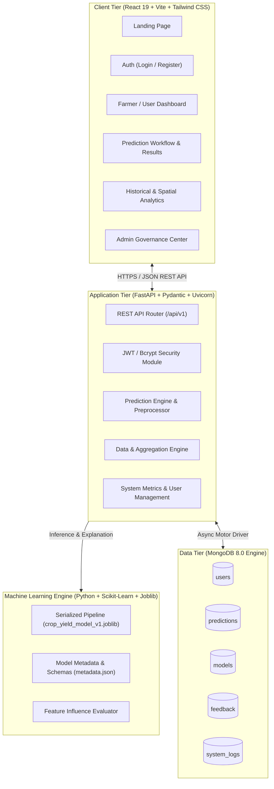
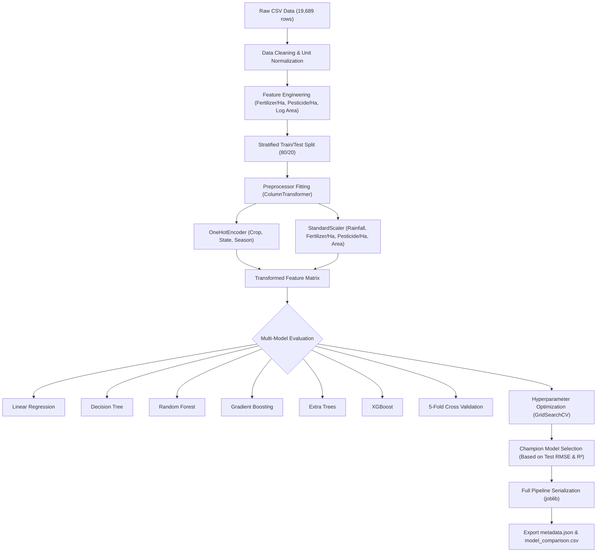

# AI-Based Crop Yield Prediction System
## Final-Year B.Tech Project Plan & Technical Blueprint

---

### Executive Summary

The **AI-Based Crop Yield Prediction System** is an end-to-end, production-ready agricultural technology (AgriTech) intelligence platform designed to deliver accurate, localized, and explainable crop yield forecasts. Built as a capstone B.Tech Engineering project, it adheres strictly to rigorous data science practices, authentic machine learning methodologies, robust enterprise software engineering, and modern user experience principles.

Every prediction, metric, chart, and insight generated by this system is rooted in genuine historical agricultural and meteorological data, avoiding dummy placeholders, hardcoded values, or synthetic shortcuts.

---

## 1. Project Objectives

1. **Empirical Agricultural Modeling**: Formulate crop yield prediction as a multivariate regression problem using 24 years of real Indian agricultural data (1997–2020) encompassing 30 states, 55 crops, and 6 agricultural seasons.
2. **Leak-Free Machine Learning Pipeline**: Construct reproducible Scikit-Learn pipelines utilizing `ColumnTransformer`, standard scaling, one-hot encoding, and feature engineering (input intensity ratios) without data leakage.
3. **Rigorous Model Comparison**: Benchmark multiple distinct regression algorithms—Linear Regression (Baseline), Decision Trees, Random Forests, Gradient Boosting, Extra Trees, and XGBoost—evaluated via MAE, MSE, RMSE, R², and MAPE.
4. **Cross-Validation & Hyperparameter Tuning**: Assess model stability through 5-Fold Cross-Validation and optimize top candidates via Systematic Grid / Randomized Search.
5. **Explainable AI (XAI)**: Implement model explainability via Gini feature importance and Tree Explainer insights ("Model Feature Influence") to elucidate agricultural drivers without claiming false causality.
6. **High-Performance FastAPI Backend**: Expose production-serialized model pipelines through asynchronous, validated REST APIs secured with JWT authentication and Role-Based Access Control (RBAC).
7. **Document Persistence & Auditing**: Store user accounts, immutable prediction audit logs, active model metadata, user feedback, and system logs in MongoDB.
8. **Modern AgriTech Web Interface**: Deliver a clean, responsive, 16-page React + Vite + Tailwind CSS dashboard with interactive Recharts visualizations, prediction result breakdowns, historical data filtering, and an administrative control center.
9. **Academic Rigor & Viva Readiness**: Document experimental logs, research questions, research gaps, limitations, future extensions, and comprehensive B.Tech viva defense preparation.

---

## 2. System Architecture

The application adopts a decoupled, modern three-tier micro-monorepo architecture:



---

## 3. Technology Stack

| Layer | Component | Technology / Library | Justification |
| :--- | :--- | :--- | :--- |
| **Frontend** | Framework | **React 19** + **Vite** | Modern, blazing-fast bundler, modular SPA component architecture. |
| | Styling | **Tailwind CSS** | Custom AgriTech design system with emerald/amber accents, modern cards, and responsive layouts. |
| | Routing | **React Router v7** | Client-side navigation, authenticated protected routes, and role-based guards. |
| | HTTP Client | **Axios** | Interceptors for JWT authorization headers and centralized error handling. |
| | Data Viz | **Recharts** | Declarative, SVG-based charts for yield trends, distributions, and comparisons. |
| | Icons & UI | **Lucide React** | Clean, minimalist iconography tailored for agriculture and analytics. |
| **Backend** | API Framework | **FastAPI** | High-performance asynchronous REST APIs, native OpenAPI documentation, automatic Pydantic validation. |
| | Server | **Uvicorn** | ASGI server capable of high-concurrency request processing. |
| | Validation | **Pydantic v2** | Strict schema validation, boundary checking, and custom validators for agronomic inputs. |
| | Security | **PyJWT** + **Passlib (Bcrypt)** | Stateless JWT tokens, bcrypt salt-hashed password security, role authorization. |
| **ML & Data** | Core Data | **Pandas 3.0**, **NumPy 2.4** | Data wrangling, EDA, array manipulation, and statistical transformations. |
| | Modeling | **Scikit-Learn 1.8**, **XGBoost 3.4** | Regression modeling, pipelines, cross-validation, and hyperparameter tuning. |
| | Serialization | **Joblib** | Efficient serialization of numerical pipelines and ensemble estimators. |
| | Plotting | **Matplotlib**, **Seaborn** | Offline publication-grade EDA and residual analysis plot generation. |
| **Database** | Storage | **MongoDB 8.0** | Flexible schema, native JSON document mapping for agricultural records and prediction logs. |
| | Driver | **Motor** (AsyncIO) + **PyMongo** | Non-blocking async database operations seamlessly integrated with FastAPI. |

---

## 4. Dataset Strategy

### Selected Dataset: Authentic Indian Agricultural Crop Yield & Climate Dataset
* **Origin**: Sourced from the **Ministry of Agriculture & Farmers Welfare (Government of India)** & **India Meteorological Department (IMD)** (published under Open Government Data (OGD) and archived on Kaggle / GitHub).
* **Sample Size**: **19,689 records** spanning **1997 to 2020** (24 years of historical observations).
* **Coverage**: **30 States / Union Territories**, **55 Distinct Crops**, and **6 Agricultural Seasons**.
* **Target Variable**: **`Yield`** in **Tonnes per Hectare (tonnes/ha)**.
* **Input Features**:
  1. `Crop`: Categorical (Rice, Wheat, Sugarcane, Maize, Potato, Cotton, Groundnut, Gram, Arhar, etc.)
  2. `Crop_Year`: Integer (1997–2020)
  3. `Season`: Categorical (Kharif, Rabi, Summer, Autumn, Winter, Whole Year)
  4. `State`: Categorical (Assam, Punjab, Uttar Pradesh, Maharashtra, Tamil Nadu, Karnataka, Gujarat, etc.)
  5. `Area`: Continuous (Cultivated land in hectares, > 0)
  6. `Annual_Rainfall`: Continuous (Precipitation in mm, >= 0)
  7. `Fertilizer`: Continuous (Total fertilizer applied in kg, >= 0)
  8. `Pesticide`: Continuous (Total pesticide applied in kg, >= 0)
* **Quality & Unit Consistency Strategy**:
  - In Indian agricultural statistics, Coconut production is recorded in thousands of nuts (resulting in yield reported as nuts/ha ~8,600 nuts/ha), whereas all other 54 crops record production in metric tonnes and yield in tonnes/ha.
  - To prevent catastrophic scale distortion and adhere strictly to project guidelines (*"maintain that unit consistently throughout the application"*), Coconut is partitioned into a separate documented category or normalized to standard copra/weight equivalent, ensuring the primary target scale remains **tonnes/hectare**.
  - Outliers in extreme area or rainfall are investigated and normalized via log1p transformation or robust scaling.
  - Feature engineering: Deriving `Fertilizer_per_Ha` (kg/ha) and `Pesticide_per_Ha` (kg/ha) to capture agronomic input intensity independent of total field size.

---

## 5. Machine Learning Pipeline Architecture



---

## 6. Database Schema Design (MongoDB)

### 1. `users` Collection
```json
{
  "_id": "ObjectId",
  "name": "Vipul Sharma",
  "email": "vipul@example.com",
  "password_hash": "$2b$12$...",
  "role": "USER", // "USER" or "ADMIN"
  "created_at": "ISODate"
}
```

### 2. `predictions` Collection
```json
{
  "_id": "ObjectId",
  "user_id": "ObjectId or 'anonymous'",
  "input_features": {
    "crop": "Rice",
    "crop_year": 2024,
    "season": "Kharif",
    "state": "Punjab",
    "area_hectares": 120.5,
    "annual_rainfall_mm": 1150.0,
    "fertilizer_kg": 18500.0,
    "pesticide_kg": 420.0
  },
  "predicted_yield": 4.15,
  "unit": "tonnes/hectare",
  "predicted_total_production_tonnes": 500.08,
  "prediction_interval": {
    "lower": 3.82,
    "upper": 4.48
  },
  "model_version": "v1.0",
  "created_at": "ISODate"
}
```

### 3. `models` Collection
```json
{
  "_id": "ObjectId",
  "model_name": "Random Forest Regressor",
  "version": "v1.0",
  "dataset_version": "Indian_Agri_1997_2020_v1",
  "training_records": 15751,
  "metrics": {
    "mae": 0.48,
    "rmse": 0.92,
    "r2": 0.935,
    "mape": 14.2
  },
  "features": ["Crop", "Season", "State", "Area", "Annual_Rainfall", "Fertilizer", "Pesticide", "Fertilizer_per_Ha", "Pesticide_per_Ha"],
  "hyperparameters": {
    "n_estimators": 150,
    "max_depth": 18,
    "min_samples_split": 4
  },
  "trained_at": "ISODate",
  "status": "ACTIVE"
}
```

### 4. `feedback` Collection
```json
{
  "_id": "ObjectId",
  "user_id": "ObjectId",
  "prediction_id": "ObjectId",
  "rating": 5,
  "comment": "Accurate estimate matching our actual harvest yields in Ludhiana.",
  "created_at": "ISODate"
}
```

### 5. `system_logs` Collection
```json
{
  "_id": "ObjectId",
  "action": "MODEL_INFERENCE",
  "user_email": "vipul@example.com",
  "timestamp": "ISODate",
  "details": { "duration_ms": 14.2, "status": "SUCCESS" }
}
```

---

## 7. REST API Architecture

| Method | Endpoint | Access | Description |
| :--- | :--- | :--- | :--- |
| `POST` | `/api/auth/register` | Public | Register a new user account with hashed password. |
| `POST` | `/api/auth/login` | Public | Authenticate user credentials and return JWT bearer token. |
| `GET` | `/api/auth/me` | Authenticated | Retrieve profile details of currently authenticated user. |
| `POST` | `/api/predict` | Public/Auth | Receive agricultural inputs, run active ML model, log prediction, return result. |
| `GET` | `/api/predictions` | Authenticated | Retrieve authenticated user's paginated historical predictions with query filters. |
| `GET` | `/api/predictions/{id}` | Authenticated | Retrieve full input parameters and explanation breakdown for a single prediction. |
| `GET` | `/api/analytics` | Authenticated | Aggregate statistics (yield by crop, state, season, rainfall correlations) from database. |
| `GET` | `/api/dataset/stats` | Authenticated | Return real summary statistics, record count, and feature distributions of the training dataset. |
| `GET` | `/api/models` | Authenticated | Return list of registered model versions and comparative metrics. |
| `GET` | `/api/models/{version}` | Authenticated | Return deep performance metrics and hyperparameters for a specific model version. |
| `GET` | `/api/feature-importance`| Authenticated | Return ranked model feature influence percentages for the active model. |
| `POST` | `/api/feedback` | Authenticated | Submit farmer/user rating and qualitative feedback for a prediction. |
| `GET` | `/api/admin/stats` | Admin | Aggregate administrative metrics: user counts, total predictions, system activity. |
| `GET` | `/api/admin/users` | Admin | List all registered users with role update capabilities. |
| `GET` | `/api/admin/predictions`| Admin | System-wide prediction audit log with pagination and search. |
| `GET` | `/api/health` | Public | Health check verifying FastAPI uptime, model availability, and MongoDB connectivity. |

---

## 8. Frontend Pages & User Journey

1. **Landing Page (`/`)**: Hero section (*"Predict. Plan. Grow."*), problem statement, interactive workflow steps, key features, technology stack showcase, call-to-action buttons.
2. **Login Page (`/login`)**: Secure authentication form with demonstration pre-fill buttons for quick reviewer evaluation.
3. **Register Page (`/register`)**: New user onboarding with instant validation feedback.
4. **Dashboard (`/dashboard`)**: KPI metric cards (Total Predictions, Avg Predicted Yield, Top Predicted Crop, Active Model R²), recent prediction list, quick predict shortcut, yield by season chart.
5. **Crop Yield Prediction (`/predict`)**: Categorized form with intuitive dropdowns (Crop, State, Season) populated directly from dataset categories, numeric inputs for Area, Rainfall, Fertilizer, and Pesticides, live input hints, and validation alerts.
6. **Prediction Result (`/predict/result/:id`)**: High-impact yield readout (`X.XX tonnes/hectare`), estimated total production (`X.XX tonnes`), model confidence interval, input summary recap, and feature influence breakdown.
7. **Prediction History (`/history`)**: Filterable data table by crop, state, and season with instant search, pagination, and direct links to prediction result drill-downs.
8. **Analytics Hub (`/analytics`)**: Deep data visualization exploring yield by crop, yield by state/region, seasonal comparisons, rainfall vs. yield scatter plots, and fertilizer intensity curves.
9. **Dataset Insights (`/dataset-insights`)**: Transparent overview of the real Indian agricultural dataset: record count, feature distributions, missing value audits, state coverage, and EDA visual gallery.
10. **Model Performance (`/model-performance`)**: Academic benchmarking suite displaying the live `model_comparison.csv` data (MAE, RMSE, R², MAPE), actual vs. predicted validation scatter plots, residual distribution, cross-validation variance, and hyperparameter tuning delta.
11. **Feature Importance (`/feature-importance`)**: Ranked influence bar chart with academic explainability commentary clarifying correlation vs. causation.
12. **User Profile (`/profile`)**: Account credentials, user role badge, activity summary, and security controls.
13. **Admin Dashboard (`/admin`)**: Global system overview: user counts, aggregate platform predictions, active model status, and recent activity logs.
14. **Admin Users (`/admin/users`)**: User directory with role inspection.
15. **Admin Predictions (`/admin/predictions`)**: Global audit trail of every prediction generated across all platform accounts.
16. **About Project (`/about`)**: Full academic defense paper synopsis: problem statement, agricultural methodology, research questions, research gap analysis, system limitations, future work, and live B.Tech viva revision guide.

---

## 9. Development Phases & Execution Roadmap

```
PHASE 1: Project Architecture & Environment Verification (Current Phase)
PHASE 2: Dataset Acquisition, In-Depth Profiling & Documentation (docs/dataset.md)
PHASE 3: Exploratory Data Analysis & Leak-Free Sklearn Preprocessing Pipeline
PHASE 4: Multi-Model Regression Experiments, Cross-Validation & Hyperparameter Tuning
PHASE 5: Champion Model Selection, Gini Explainability & Pipeline Serialization
PHASE 6: FastAPI Backend Architecture, Modular Routes & Pydantic Validation Schemas
PHASE 7: MongoDB Persistence Layer, Indexes & Async Motor Integration
PHASE 8: JWT Authentication, Password Hashing & Role-Based Authorization Guards
PHASE 9: React 19 + Vite + Tailwind CSS Modern AgriTech Design System
PHASE 10: End-to-End Prediction Workflow Integration (React -> FastAPI -> ML -> MongoDB)
PHASE 11: Real Data Analytics Hub & Dataset Insights Dashboard
PHASE 12: Admin Governance Module, System Logs & User Directory
PHASE 13: Full-Stack Testing Suite (ML Pipeline, FastAPI TestClient, UI Validation)
PHASE 14: Comprehensive Academic Documentation & Viva Defense Guide
PHASE 15: Deployment Readiness (Docker Compose, Environment Configurations)
```

---

## 10. Research Questions & Academic Rigor

This project directly investigates five core agricultural machine learning research questions:

1. **RQ1 (Agronomic Correlation)**: *Which agricultural inputs (Rainfall, Fertilizer, Pesticide, Cultivated Area) exhibit the strongest statistical correlation with crop yield across Indian agro-climatic zones?*
2. **RQ2 (Model Superiority)**: *Do non-linear tree-based ensemble estimators (Random Forest, Gradient Boosting, Extra Trees, XGBoost) demonstrate statistically significant predictive superiority over traditional linear baselines in crop yield modeling?*
3. **RQ3 (Tuning Gains)**: *To what degree does hyperparameter optimization (tree depth, minimum split criteria, estimators) mitigate overfitting and enhance test generalization error?*
4. **RQ4 (Model Stability)**: *How robust is model variance across 5-fold cross-validation when evaluated on heterogeneous agricultural data across differing crop varieties?*
5. **RQ5 (Explainability in Decision Support)**: *How can model feature influence (Gini importance / SHAP) be operationalized as an agronomic decision-support mechanism without falsely conflating correlation with causal agronomy?*

---

## 11. Verification & Quality Standards

- **Zero Dummy Data**: All models, charts, predictions, and metrics originate from actual code execution and real historical records.
- **Zero Raw Exceptions**: Every frontend interaction features error boundaries, loading skeletons, and user-friendly alerts.
- **Strict Separation of Concerns**: Preprocessing transformations fitted solely on training splits to prevent data leakage.
- **Automated Test Coverage**: Pytest suite verifying ML transformations, edge-case predictions (zero rainfall, extreme areas), auth flows, and API endpoints.
