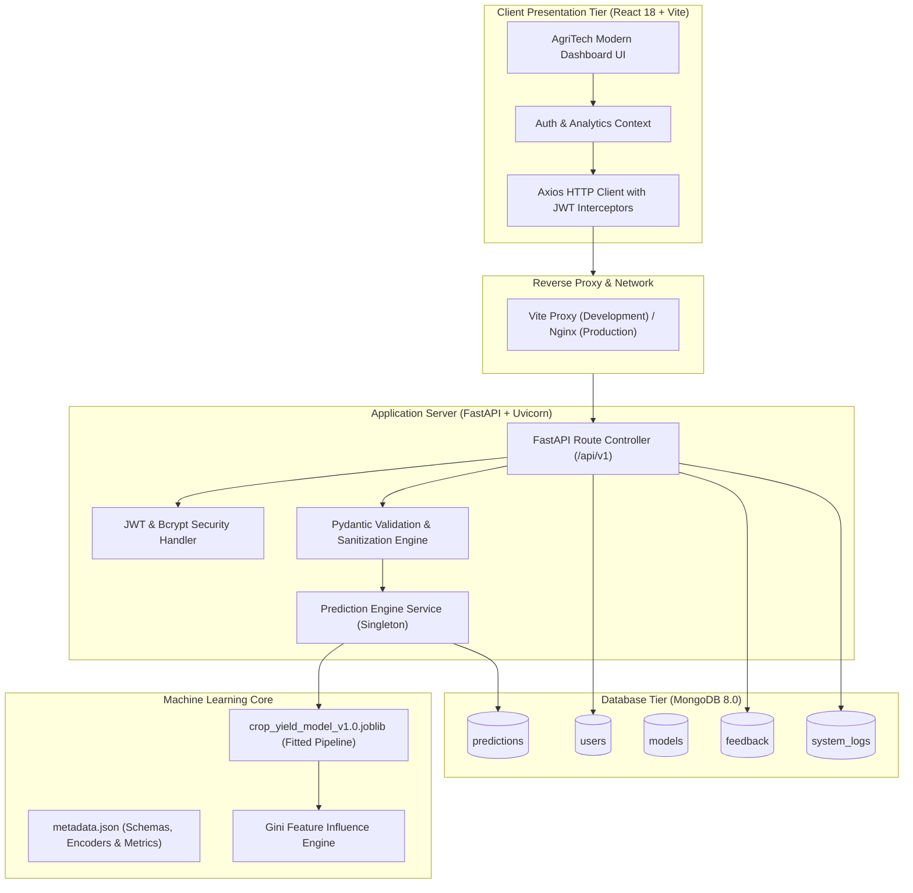

# System Architecture & Technical Specifications

## 1. High-Level Architectural Pattern

The **AI-Based Crop Yield Prediction System** is structured as an enterprise-grade three-tier decoupled architecture:
1. **Presentation Layer**: Single-Page Application (SPA) built with React 18, Vite, and Tailwind CSS, communicating over asynchronous JSON HTTP APIs.
2. **Application / Service Layer**: Asynchronous RESTful microservice built with FastAPI, Pydantic v2 data contracts, and Motor (AsyncIO MongoDB driver).
3. **Machine Learning & Persistence Layer**: Serialized Scikit-Learn `ColumnTransformer` + `Pipeline` regression models and a multi-collection MongoDB 8.0 document database.

---

## 2. Component Specifications

### A. Preprocessing Pipeline Design
- **Isolation Principle**: All scalers and categorical encoders are strictly encapsulated inside Scikit-Learn's `Pipeline` object.
- **Categorical Handling**: `OneHotEncoder(handle_unknown='ignore', sparse_output=False)` handles 54 crop varieties, 30 states, and 6 seasons without out-of-vocabulary crashes.
- **Numerical Scaling**: `StandardScaler` standardizes area, annual precipitation, fertilizer per hectare, pesticide per hectare, and crop year.
- **Agronomic Ratio Transformation**: Gross fertilizer and pesticide totals are converted to land-independent density metrics (`kg/ha`) before feeding into the estimators.

### B. Security & Authentication
- **Password Protection**: Plaintext passwords are salted and hashed using direct `bcrypt` hashing with 12 computational rounds.
- **Stateless Tokens**: HMAC-SHA256 (`HS256`) JSON Web Tokens contain subject email, user name, role, and expiration timestamps.
- **Role Guards**: Endpoints enforce role hierarchy (`USER` vs `ADMIN`).
